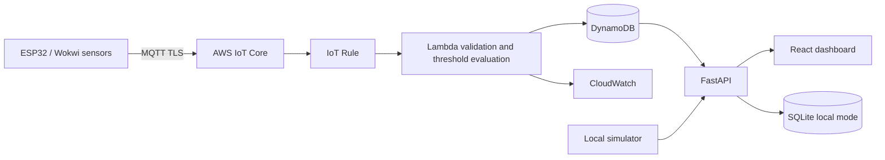

# Smart Home IoT Environmental Monitoring Platform

An original portfolio implementation for collecting ESP32 environmental telemetry, processing threshold alerts, and viewing device readings in a responsive dashboard.

## Current implementation

- Local-first FastAPI service with validated telemetry, SQLite persistence, device/history/alert/summary endpoints, and OpenAPI docs.
- React and TypeScript dashboard with live polling and temperature trend chart.
- Synthetic reading publisher for local demonstrations.
- ESP32 Arduino/PlatformIO source, DHT22 and analog air-quality input, MQTT topic conventions, TLS client setup, reconnect backoff, and retained Last Will status.
- AWS Lambda event validation and DynamoDB persistence; Terraform foundation for DynamoDB, Lambda, IoT rule, IAM, log retention, and alarms.
- Docker Compose and GitHub Actions for backend, frontend, firmware, Terraform checks, and image builds.

## Local quick start

Install Docker Desktop and run:

```sh
docker compose up --build
```

Open http://localhost:5173 for the dashboard and http://localhost:8000/docs for API docs. Local mode seeds readings into SQLite. To publish synthetic updates, run `python simulator/publisher.py` on a host with Python 3.12.

## Architecture



## Repository

`firmware/` ESP32 source and Wokwi wiring; `backend/` API and tests; `frontend/` dashboard; `cloud/lambda/` AWS processor; `infra/terraform/` infrastructure definitions; `simulator/` local publisher; `docs/` deployment and design notes.

## Configure and deploy

Copy `.env.example` to a local environment file and adjust values. Never put credentials, private keys, or device certificates in source control. Firmware requires a local ignored `config.h` plus securely provisioned CA/certificate/private key definitions. See [setup](docs/SETUP.md), [AWS deployment](docs/AWS_DEPLOYMENT.md), [API](docs/API.md), and [security](SECURITY.md).

Terraform is infrastructure source only. No AWS resources have been deployed. Inspect and customize networking, ECS, account policy, state backend, and deployment packaging before using `terraform plan`/apply. Production deployment is always an explicit operator action.

## Verification and limitations

Backend tests: `cd backend && pip install -r requirements.txt pytest httpx && PYTHONPATH=. pytest`. Frontend build: `cd frontend && npm install && npm run build`. Terraform checks are in the infrastructure workflow. Local execution and cloud deployment have not been run from this environment.

The AWS API read adapter and ECS production service are not wired into the dashboard yet; local mode uses SQLite. Wokwi does not provide AWS IoT certificate provisioning, so hardware cloud operation requires a real certificate and endpoint. Thresholds are configurable Lambda environment values and are illustrative, not universal health or safety limits.

Reference architecture inspiration: https://github.com/khaoula-ghz/smart-home-iot-monitoring (independently implemented).
