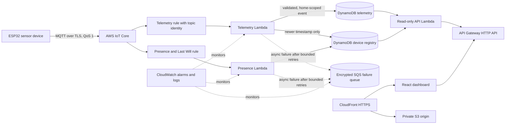
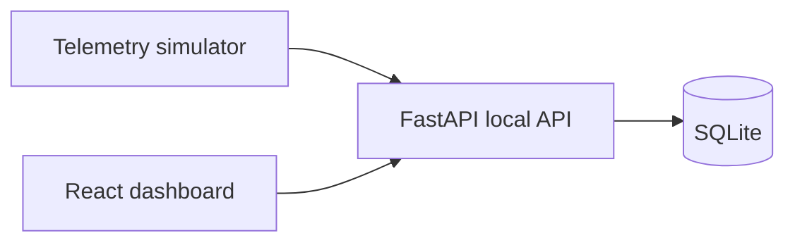

# Architecture

## Cloud data flow

The IoT rules add home and device identity from the MQTT topic. The processor checks those values against the configured home and payload before storing a reading. Telemetry is stored with a UTC timestamp and home ID. Repeated device/timestamp writes are conditional; the registry only advances to a newer telemetry timestamp. Lambda asynchronous failures are retried up to the configured limit and then sent to the encrypted SQS failure queue. An alarm fires when that queue has visible messages.

## Local demo data flow

Local mode uses SQLite and synthetic demo readings. It does not connect to AWS or reflect cloud resources.

## Storage and access patterns

- **Telemetry table:** partition key `device_id`, sort key normalized UTC `timestamp`; used for per-device history.
- **Alert index:** `alert_status` partition key and `timestamp` sort key; alert reads filter to the configured `home_id`.
- **Device registry:** `home_id` partition key and `device_id` sort key; holds latest values and presence.
- **Retention:** `expires_at` TTL is set from the configured retention period; DynamoDB TTL deletion is asynchronous.
- **API:** public, read-only API Gateway routes; Lambda IAM is limited to DynamoDB Query/GetItem. CORS permits the provisioned CloudFront origin, but CORS is not authentication. The current stack is intended for one configured home and must not serve confidential data.

The telemetry table key is not home-partitioned. Device identifiers should be globally unique when a table is shared. A true multi-tenant service needs a revised key/index layout and authenticated API authorization.

## Operations

CloudWatch log groups have configured retention. Alarms cover Lambda errors, throttles, and visible messages in the failure queue. Alarms do not currently send notifications. IoT certificates and Thing attachment are provisioned separately by an operator. See [operations](OPERATIONS.md), [security](SECURITY.md), and the [threat model](THREAT_MODEL.md).
