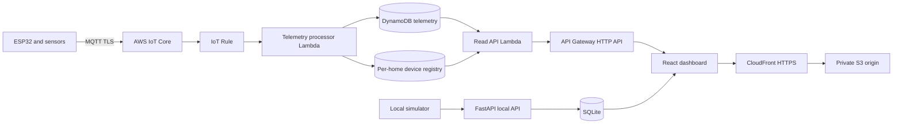

# Architecture

## Cloud data model and access patterns

- Telemetry table: partition key `device_id`, sort key normalized UTC `timestamp`; supports bounded, device-specific range queries.
- Alert GSI: `alert_status` partition key and `timestamp` sort key; supports warning/critical alert queries without scanning telemetry.
- Device registry table: `home_id` partition key and `device_id` sort key; holds the latest known sensor values for summaries and device selection.
- Processor writes each historical reading and conditionally updates registry state only when its timestamp is newer, preventing delayed messages from replacing a newer device state.
- Read API is public but read-only, CORS-limited to the CloudFront origin, rate-limited, and has DynamoDB Query/GetItem permissions only.

Local mode uses SQLite demo data. AWS resources are Terraform definitions and are not deployed by this repository automatically. IoT certificates and Thing attachment are provisioned separately by an operator.
