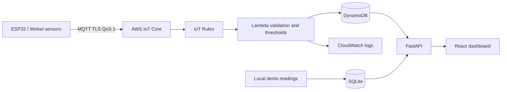

# Architecture

The local dashboard uses SQLite demo data. AWS-mode data access remains an integration point; the Lambda and Terraform establish a cloud ingestion foundation. Table keys are device_id and ISO-8601 UTC timestamp for per-device range queries.
